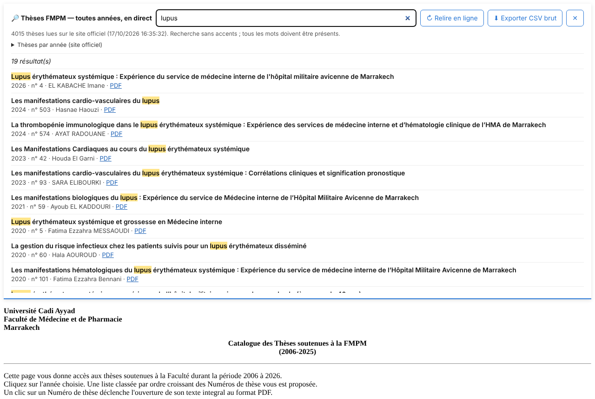
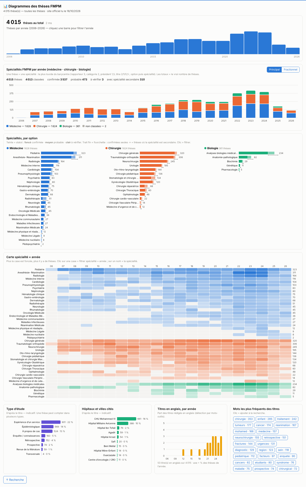

# Thèses de médecine au Maroc : recherche

Moteur de recherche des thèses soutenues dans les facultés de médecine marocaines : FMPM Marrakech, FMPR Rabat (médecine et pharmacie) et FMP Fès. Il sert à vérifier qu'un sujet n'a pas déjà été traité.

- **Page :** `index.html`. Elle lit les CSV du dossier `archive/`.
- **Recherche en direct sur le site de la FMPM (toujours à jour) :** userscripts dans [`userscripts/`](userscripts/README.md) — voir plus bas.
- **Spécialités :** les thèses sont classées selon la [liste officielle des spécialités de la FMPM](archive/specialites/liste-specialites-fmpm-2024.pdf) (42 spécialités : médecine, chirurgie, biologie ; en texte brut : [`specialites-fmpm.txt`](archive/specialites/specialites-fmpm.txt)), par correspondance avec le libellé de chaque source — 97 % des thèses de Fès, une partie des thèses de pharmacie de Rabat. Recherche `spe:"oncologie medicale"`, `option:chirurgie`. Règles et table : [`archive/specialites/`](archive/specialites/README.md).
- **Sources et limites :** [`archive/sources-theses-maroc.md`](archive/sources-theses-maroc.md)
- **En local :** `python3 -m http.server`, puis http://localhost:8000/

Dans la page : recherche sans accents (`diabete` trouve « DIABÈTE »), filtres faculté / années, graphique par année. Les noms de rapporteurs, spécialités et mots-clés sont **cliquables** ; le panneau **🧭 Affiner** compte, pour les résultats, les spécialités et les rapporteurs les plus fréquents ; **🗂 Fiche** ouvre une thèse avec son propre lien (`#fiche=fmpm-2024-5`). Syntaxe complète : bouton **?**.

Les données sont les listes que les facultés publient déjà (titre, auteur, année, rapporteur). Les résumés et les PDF ne sont pas republiés : la page renvoie vers les sources officielles. Vérifiez toujours un sujet sur [Toubkal](https://toubkal.imist.ma/search).

## Userscripts pour le site officiel de la FMPM

Deux scripts qui s'exécutent **sur** le catalogue officiel (https://wd.fmpm.uca.ma/biblio/theses/Accueil.html) et relisent toutes les années en direct :

- [`userscripts/v0-stable.js`](userscripts/v0-stable.js) — barre de recherche en haut + export CSV brut (même code que la [version Greasy Fork](https://greasyfork.org/scripts/600588), installable en un clic).
- [`userscripts/v0.1-diagrams.js`](userscripts/v0.1-diagrams.js) — la même barre en haut + **diagrammes dynamiques en pied de page** qui suivent la recherche : thèses par année, spécialités FMPM (médecine / chirurgie / biologie, un camembert par option), type d'étude, hôpitaux cités, titres en anglais, mots fréquents.

**Lancer :** ouvrir le catalogue → **F12** → **Console** → coller tout le fichier → **Entrée** ; ou le coller comme nouveau script dans un gestionnaire de userscripts (Tampermonkey, Violentmonkey). Détails : [`userscripts/README.md`](userscripts/README.md).

## These2.0 FMPM — recherche + tableau de bord (`these2/`)

Moteur de recherche et statistiques des ≈ 4 000 thèses de Marrakech, classées dans les 42 spécialités officielles de la FMPM (les classements devinés sont marqués « ? »). Fusionné ici depuis l'ancien dépôt `these2.0` (conservé en branche `old`).

- **Site :** `these2/index.html` (recherche) et `these2/dashboard.html` (graphiques cliquables).
- **Visuels :** [`visuals/`](visuals/) — les mêmes graphiques, ouverts depuis le bouton 📊 de la page d'accueil (données lues dans `these2/`).
- **Mise à jour hebdomadaire :** `.github/workflows/update-these2.yml`, chaque lundi 04:17 UTC, relit le site officiel de la FMPM ; données et graphiques ne sont réécrits que si le site a changé, sinon seule la date de contrôle (`these2/data/status.json`) est mise à jour. Lancement manuel : Actions → *Update These2.0 data* → Run workflow.
- **À chaque visite :** les pages relisent `these2/data/*.json` sans cache (`cache: "no-cache"`), donc elles montrent toujours la dernière version publiée, avec « vérifié le … » (⚠ si le contrôle a plus de 9 jours). Le site officiel n'envoie pas d'en-tête CORS : un navigateur ne peut pas le relire lui-même, d'où le contrôle côté GitHub Actions.
- **Code du pipeline :** `pipeline/scripts/` (Python : `update_theses.py`, `specialites.py`, `build_charts.py`) ; contexte détaillé : `pipeline/CONTEXT-these2.md`.
